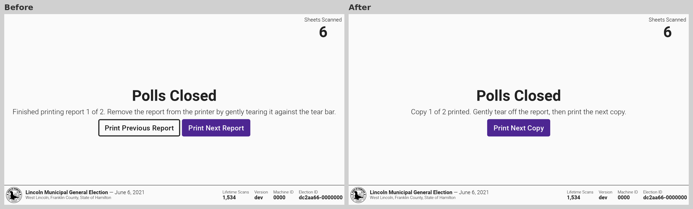
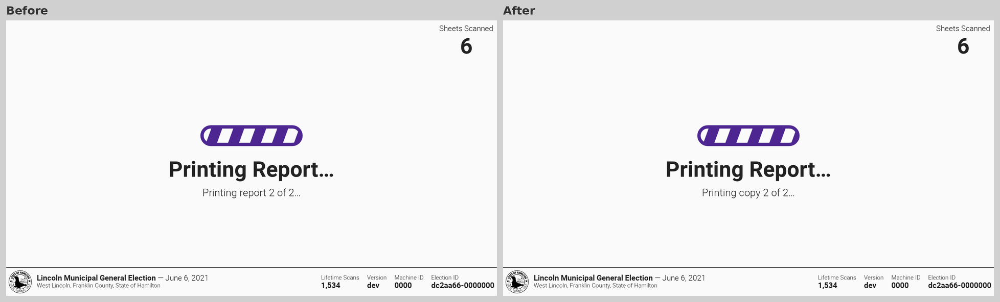
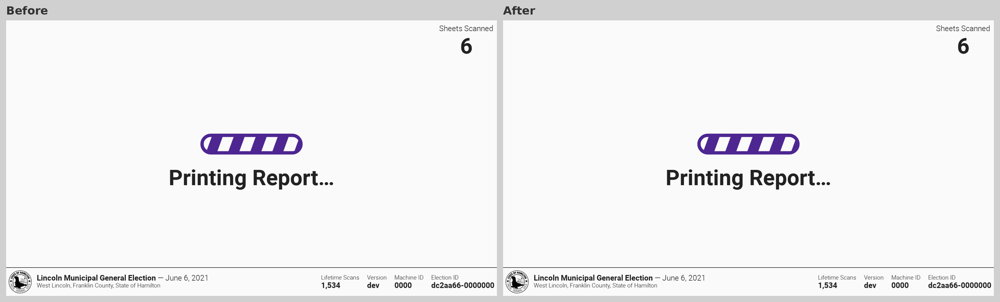
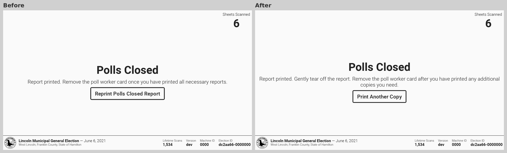
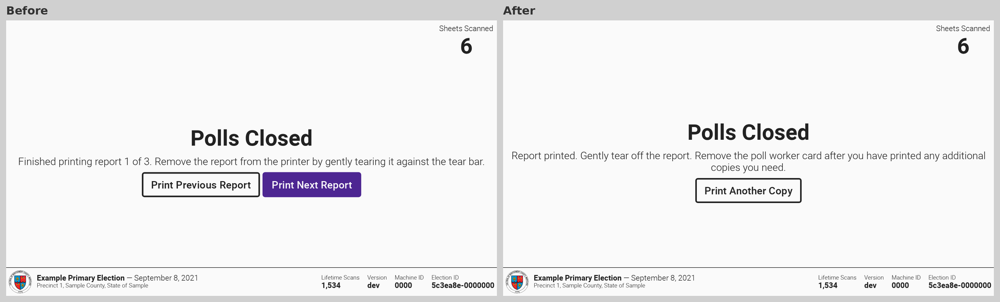

# VxScan report copy screens: before and after

Before is `main`; after is `scan/continuous-primary-reports`. Polls closed
report throughout.

## Two copies configured

### 1. After the first copy prints

### 2. While the second copy prints

### 3. After the last copy prints

### 4. While an additional copy prints

### 5. After an additional copy prints

## One copy configured

### 6. After the report prints

### 7. Primary election, after the first print

Before, this was the first of three party sections. After, the whole report
has printed.

